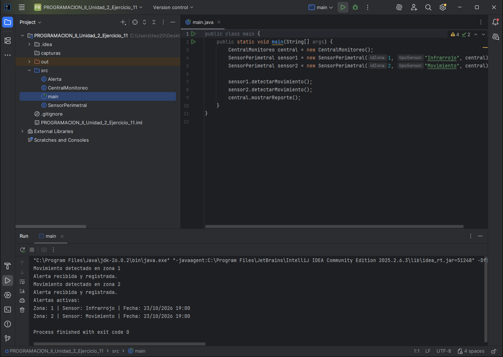

# PROGRAMACIÓN II — Unidad 2, Ejercicio 11: El Sistema de Alarmas y Monitoreo de Seguridad

Trabajo práctico de Programación II. Este repositorio contiene la resolución en Java del ejercicio 11 de la Unidad 2.

## Consigna

#### Contexto

En una urbanización privada, los diferentes sensores perimetrales (como barreras infrarrojas o cámaras de movimiento) necesitan reportar incidentes de forma inmediata. Para ello, un sensor no toma acciones por sí mismo, sino que envía un mensaje de alerta a un objeto centralizador de monitoreo que decide qué protocolo activar.

#### Consigna

Modelar la comunicación en Java donde un objeto SensorPerimetral envía un mensaje de alarma a un objeto CentralMonitoreo, pasando información relevante sobre la zona del incidente.

#### Desarrollo requerido

- Crear la clase Alerta que encapsule atributos como idZona, tipoSensor y marcaTemporal.
- Diseñar la clase CentralMonitoreo con un método procesarAlerta(Alerta alerta) que registre el evento en una lista de incidentes activos.
- Implementar la clase SensorPerimetral con una referencia a la CentralMonitoreo y un método detectarMovimiento() que dispare el envío del mensaje.
- En el método main, instanciar la central, al menos dos sensores asociados a ella, simular activaciones y mostrar el reporte de alertas por consola.

## Estructura del repositorio

```
PROGRAMACION_II_Unidad_2_Ejercicio_11/
├── README.md
├── capturas/
│   └── consola.png
└── src/
    ├── Alerta.java
    ├── CentralMonitoreo.java
    ├── main.java   # clase con el método main
    └── SensorPerimetral.java
```

## Funcionamiento y lógica

El ejercicio simula un sistema de alarma: los sensores detectan movimiento y le envían una alerta a la central de monitoreo, que las registra.

### `Alerta`

Guarda `idZona`, `tipoSensor` y `marcaTemporal`. Sobrescribe `toString()` para que, al imprimirla, muestre la zona, el sensor y la fecha en una sola línea.

### `CentralMonitoreo`

Tiene una lista (`ArrayList`) de incidentes activos.

- **`procesarAlerta(Alerta)`:** agrega la alerta a la lista y confirma que la registró.
- **`mostrarReporte()`:** imprime todas las alertas activas.

### `SensorPerimetral`

Tiene su zona, su tipo y una referencia a la central (que recibe en el constructor). Su método `detectarMovimiento()` avisa que detectó movimiento, arma un objeto `Alerta` con sus datos y se lo envía a la central con `procesarAlerta()`.

### `main`

Crea la central y dos sensores conectados a ella: uno **infrarrojo** en la zona 1 y otro de **movimiento** en la zona 2. Los dos detectan movimiento y al final la central muestra el reporte con las dos alertas registradas.

## Ejecución

Captura de la consola de IntelliJ IDEA ejecutando el programa:



Salida obtenida:

```
Movimiento detectado en zona 1
Alerta recibida y registrada.
Movimiento detectado en zona 2
Alerta recibida y registrada.
Alertas activas:
Zona: 1 | Sensor: Infrarrojo | Fecha: 23/10/2026 19:00
Zona: 2 | Sensor: Movimiento | Fecha: 23/10/2026 19:00
```
